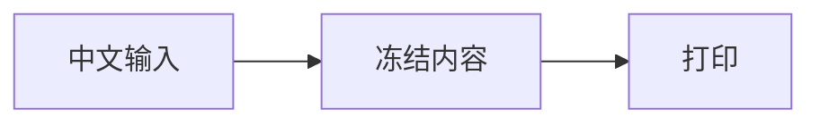

# P5 Unicode 原码位验收

原文不做 NFC/NFKC 归一化；外观相同的字符必须保留各自码位。

ALIAS_TEXT: 文一人口

ALIAS_RADICAL: ⽂⼀⼈⼝

QUOTES: `const message = '中文代码';`

COMBINING: é é Å Å

LIGATURE: office ffi fi ffi fi

EMOJI: 😀 👩🏽‍💻 ❤️

ARABIC: العربية لا

HEBREW: שלום

SVG:

UNICODE-END-MARKER
