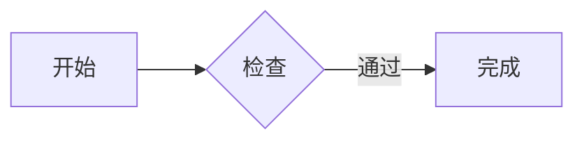
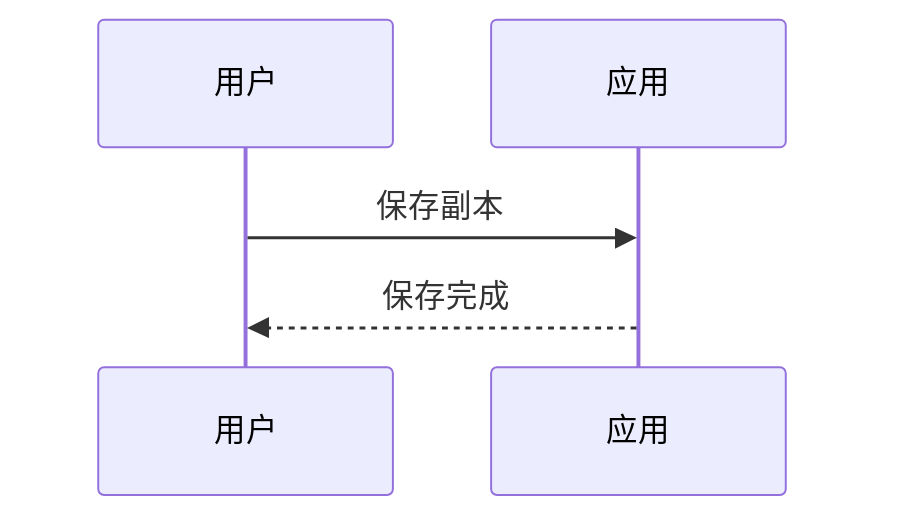
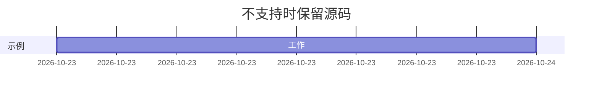

# milkup 2.0.0-beta.7 手测样例

文档身份：将两份副本分别改成 A、B。

保存标记：ORIGINAL。只编辑独立测试副本。

菜单选择目标：MENU_SELECTED_中文🙂。可以从右向左拖选同一段，再复制、剪切、撤销。

输入位置：开始｜在这里输入中文｜结束。组合字符：é / é；emoji：🙂🧑‍💻。

## 外观对照

外观标记：THEME_ORIGINAL。主题导入、明暗切换、菜单开关和恢复默认本身不应改动此文档。

正文、**粗体**、_斜体_、~~删除线~~、`INLINE_THEME_中文🙂` 和 [示例链接](https://example.invalid/appearance)。只观察颜色和文本装饰，不需要打开链接。

> THEME_QUOTE：检查明暗模式下引用文字与背景可读；中文 English 🙂 保持原样。

### THEME_HEADING：标题与选区

从右向左选中这段 THEME_SELECTION_中文🙂，切换外观后继续点击定位、撤销与保存核对。

## Markdown 插入测试

在下一空行插入二级标题或表格，随后撤销、重做。

INSERT_HERE

- [ ] 待完成测试
- [x] 已完成测试
- 无序列表

1. 有序列表

> 引用正文。**粗体**与*斜体*后面的文字应正常。

## 表格浮层

表格前正文：TABLE_BEFORE。点击这里离开表格。

| 名称                                           |  状态  |   数值 |
| :--------------------------------------------- | :----: | -----: |
| TABLE_ORIGINAL                                 | 中文🙂 | 123.45 |
| 长单元格_ABCDEFGHIJKLMNOPQRSTUVWXYZ_0123456789 | 待检查 |     42 |

表格后正文：TABLE_AFTER。检查浮层显隐、选区和 A/B 切换。

## 代码与隐藏围栏

COPY_BEFORE

```javascript
const message = 'COPY_BODY_中文🙂'

console.log(message)
// IME_INPUT：在此输入中文，检查组合与撤销。
```

COPY_AFTER

```javascript
console.log(
  'LONG_LINE_ABCDEFGHIJKLMNOPQRSTUVWXYZ_0123456789_ABCDEFGHIJKLMNOPQRSTUVWXYZ_0123456789_ABCDEFGHIJKLMNOPQRSTUVWXYZ_0123456789_中文🙂',
)
```

EMPTY_BEFORE

```javascript

```

EMPTY_AFTER

## 已有受限流程图

块外焦点：FLOW_BEFORE。



块外焦点：FLOW_AFTER。块内可将“开始”改成“起点”，再点这里。

## 已有受限时序图

块外焦点：SEQUENCE_BEFORE。



块外焦点：SEQUENCE_AFTER。

## 不支持语法必须保留源码



UNSUPPORTED_AFTER。此块不用于声称完整 Mermaid 已实现。

## 文件尾

结束标记：END_ORIGINAL。下一代码块结束于文件尾。

```javascript
const tail = 'EOF_中文🙂'
```
