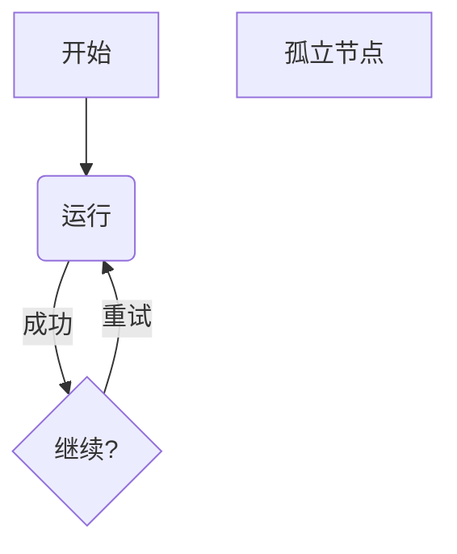
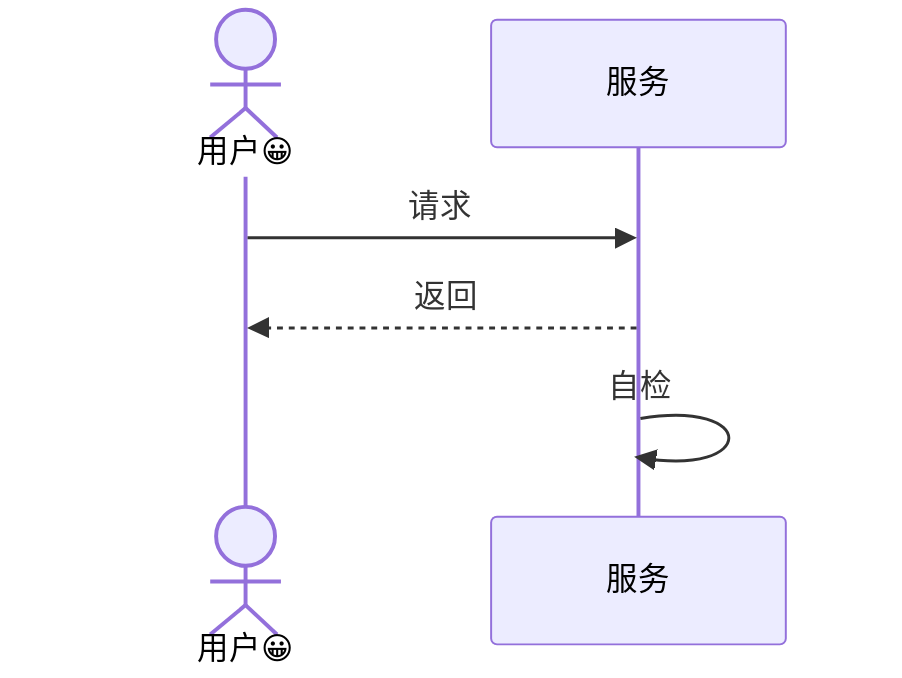
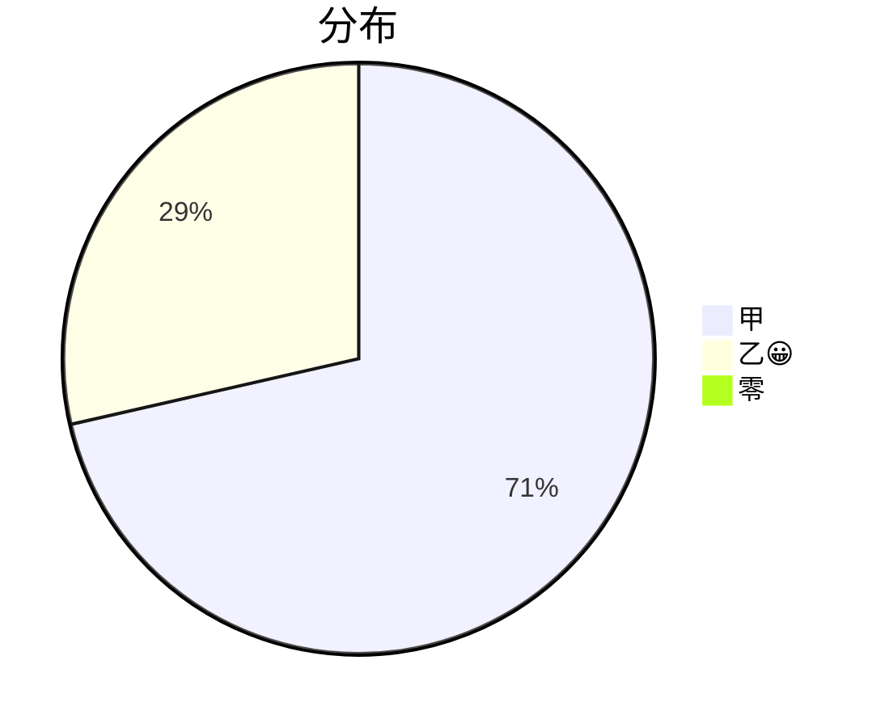

# Milkup Diagrams

独立 Worker 插件，只依赖公开 `@milkup/plugin-sdk` **0.3.3**，权限只有 `document:read`。注册 `diagrams.mermaid` 文档呈现器，仅处理宿主确认完整、上下文可信的 `mermaid` 围栏。插件不读写文件、不修改正文、不请求网络、不调用 DOM，不包含完整 Mermaid 引擎。

这是明确受限的 Mermaid 语法子集，**不宣称完整 Mermaid 兼容**。遇到任何未知语句、不完整语法、配置或预算限制时，整个图表回退为可访问的完整源码及固定错误说明，不漏画剩余部分。未知上下文/未闭合/跨出当前可信窗口的围栏继续显示源码。

## 支持语法

### 流程图



- 首句 `flowchart TD`、`flowchart TB` 或 `flowchart LR`；`graph` 是同义词。TD/TB 自上而下，LR 自左向右。
- 节点 ID 为 `[A-Za-z_][A-Za-z0-9_]*`，最多 64 个 ASCII 字符。单独 ID 显示同名矩形。
- `A[文本]` 矩形、`A(文本)` 圆角矩形、`A{文本}` 菱形。中文/emoji 支持；双引号标签 `A["文本；含 ] 符号"]` 可保留形状标点。双引号内不支持转义双引号/反斜杠。
- 有向连线 `A --> B`、`A -->|文本| B`、`A -- 文本 --> B`；允许链式 `A --> B --> C`、重复边、回边、自环、孤立节点。标签是纯文本。
- 支持换行与形状/引号外的分号分隔。重复显式节点定义最后一次生效；后续裸 ID 不清除标签或形状。
- `%%` 注释到行末；`%%{...}%%` 配置指令明确拒绝。注释标记位于形状/双引号标签内时为文本。
- 不支持 BT/RL、无向线/其它箭头、圆形/子程序等其它形状、ID 中连字符、子图、类/样式、点击动作、链接、frontmatter、配置及其它未列语句。指令保留字不能作为裸节点 ID。

### 时序图



- 首句必须是 `sequenceDiagram`。`participant ID` / `actor ID`，可选 `as 纯文本`；消息中的未声明 ID 自动成为 participant。同一 ID 的重复显式声明拒绝。
- `A->>B: 文本` 实线箭头、`A-->>B: 文本` 虚线箭头、自发消息；按源码顺序展示。虚线由安全线段组成，actor 由椭圆和线段组成。
- ID 使用流程图相同规则；消息与别名为纯文本，可有括号、中文/emoji，不支持多行、HTML、实体解码或反斜杠转义。
- 不支持 Note、激活条、loop/alt/opt/par、autonumber、创建/销毁参与者、其它箭头、配置或样式。

### 饼图



- 首句仅 `pie`；可有一个 `title 纯文本`；数据为 `"标签": 非负十进制数`，支持小数，不支持负数、指数、Infinity、showData、配置等其它语句。
- 标签不重复，合计必须为有限正数。零值保留在图例与可访问摘要，面积为零。切片用安全 polygon 近似；图例保留全部数值与百分比。很小的扇区不放扇区编号以避免重叠，其图例仍保留。

所有类型均拒绝 HTML 标签、Markdown 反引号字符串、实体解码、原始 SVG、导入、URL 动作、CSS。普通文本中的 URL 只是文字，无点击/网络能力。语法基于官方 [flowchart](https://mermaid.js.org/syntax/flowchart.html)、[sequenceDiagram](https://mermaid.js.org/syntax/sequenceDiagram.html)、[pie](https://mermaid.js.org/syntax/pie.html) 文档核对；这里列出的子集是实际产品合同。

## 布局、预算与可访问性

解析扫描有界，流程图先求强连通分量，压缩为 DAG 后分层；循环内按声明顺序展开。节点在同一层并列，连线使用层间空隙及节点区域外的独立通道，回边和自环不会造成无限递归。此布局追求确定性和完整可读的关系，不复刻 Mermaid/Dagre/ELK 的位置。

标签按 Unicode grapheme 分行，保留组合字符及 emoji 序列。Worker 使用保守字符宽度估计，未使用 DOM 测量。长图由宿主通用呈现容器负责滚动，不缩成无法阅读的小图。颜色只使用主题 token：`foreground`、`muted`、`accent`、`background`、`border`；不依赖固定浅色。输出包含全部节点/关系或消息/数据的纯文本可访问摘要，不能仅靠颜色理解数据。

上限：每图源码 **32 Ki UTF-16**、100 节点/参与者/切片、200 边/消息、每个标签 **256 UTF-16**；每次公开呈现结果合计 **256 KiB UTF-8 JSON / 4096 节点 / 128 片段**（折线/多边形的点也计节点），每片段可访问摘要最多 8192 UTF-16，向量尺寸和坐标不超过 8192。预算是上限，不是任何组合必可排版的保证：长标签、多参与者或大量虚线可更早触发布局/输出预算并整图回退。单图输出预留协议开销，组合超预算返回 `complete:false`，尚未呈现的围栏保留源码。

每个替换范围精确对应宿主完整围栏，使用绝对 UTF-16 位置；未知/部分窗口不推测正文。插件无持久缓存、无异步外部资源；遵守 AbortSignal。宿主还负责文档版本、启停/卸载、过期结果、超时及安全树校验。source 编辑与全部插件禁用时原始 Markdown 保持可用。

`target: 'screen' | 'export'` 使用同一模型与同一 typed vector/摘要，不另外输出 SVG/HTML。**这提供 P5 可复用的语义输出，并不声称 HTML/PDF/打印链路已经实现或验收。**

## 独立构建与测试

```sh
pnpm install
pnpm test
pnpm run build
node scripts/verify-external.mjs /absolute/milkup-plugin-sdk-0.3.3.tgz /outside/checkout/diagrams
```

外部验证脚本只复制本目录源码、配置与脚本，安装提供的公开 SDK tgz，执行类型检查、测试及 build；不读取 monorepo 内部包。生成 `dist/plugin.js`、构建依赖清单及 `dist/milkup.diagrams-1.0.0.milkup-plugin`。构建拒绝 SDK 以外的运行时依赖和外部导入。

测试包括完整语法消费、未知语句整图回退、循环/自环/分支连线、Unicode/CRLF、长标签画布边界、节点与输出预算、绝对范围、可信上下文、取消与 screen/export 一致性。真实宿主 Worker/浏览器/原生矩阵由集成验证另行记录，不以纯函数测试代替。
