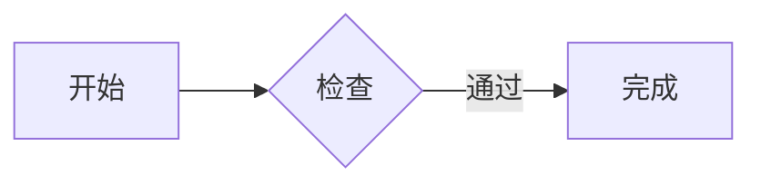
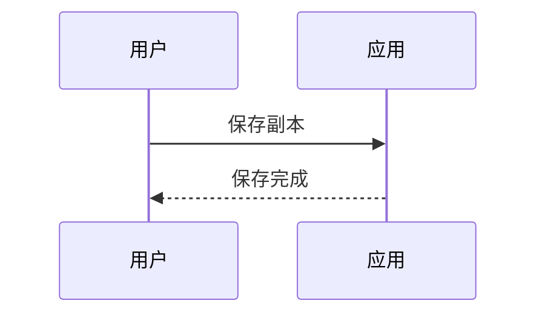
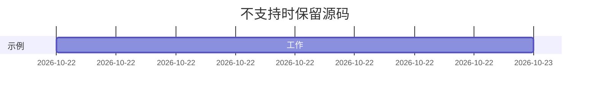

# milkup beta.4 手测样本

保存标记：尚未编辑。

中文输入测试位置：开始｜在这里输入｜结束。English 与中文交替，emoji：🙂🧑‍💻。

## 任务列表

- [ ] 待完成项目
- [x] 已完成项目
- 普通列表项目

## 粗体与斜体

**粗体中的 _斜体_** 后文应正常。English **中文 _italic_** 中文 normal。

## 表格

| L                                                               |  C   |      R |
| :-------------------------------------------------------------- | :--: | -----: |
| a                                                               | 完成 | 123.45 |
| identifier_without_breaks_ABCDEFGHIJKLMNOPQRSTUVWXYZ_0123456789 | 中间 |     42 |

## 长代码行

```js
console.log(
  'ABCDEFGHIJKLMNOPQRSTUVWXYZ_0123456789_ABCDEFGHIJKLMNOPQRSTUVWXYZ_0123456789_ABCDEFGHIJKLMNOPQRSTUVWXYZ_0123456789_ABCDEFGHIJKLMNOPQRSTUVWXYZ_0123456789_ABCDEFGHIJKLMNOPQRSTUVWXYZ_0123456789_ABCDEFGHIJKLMNOPQRSTUVWXYZ_0123456789',
)
```

## 大纲目标甲

正文甲。

### 大纲目标乙

正文乙。可修改本标题，再查看大纲刷新。

## 文档结尾

结束标记：END_原始样本。

## beta.3 代码语言与历史

```javascript
const message = '中文🙂'
console.log(message, 123)
// 选择 Python 后撤销，再切源码核对正文没有改变
```

```json
{ "name": "测试", "enabled": true, "count": 12 }
```

```python
# 中文注释
for item in [1, 2, 3]:
    print("测试🙂", item)
```

## beta.4 流程图



## beta.4 时序图



## 不支持语法应保留完整源码


