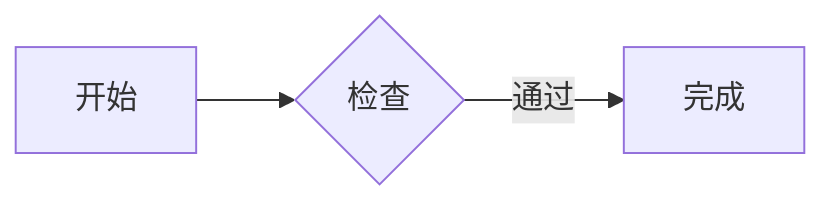
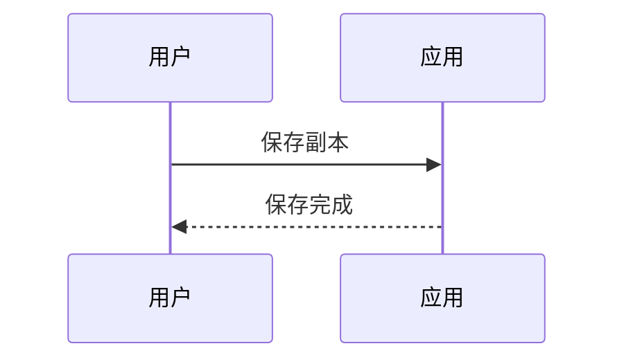
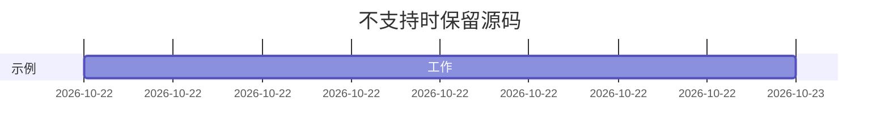

# milkup beta.5 手测样本

文档身份：将两份副本分别改成 A、B。

保存标记：尚未编辑。本文只用于副本测试。

中文输入测试位置：开始｜在这里输入｜结束。English 与中文交替，emoji：🙂🧑‍💻。

## 任务列表

- [ ] 待完成项目
- [x] 已完成项目
- 普通列表项目

## 粗体与斜体

**粗体中的 *斜体*** 后文应正常。English **中文 *italic*** 中文 normal。

## Formatting 1.0.1 表格上下文

表格前正文：TABLE_BEFORE。点击这里离开表格，工具条应隐藏。

| L                                                               |  C   |      R |
| :-------------------------------------------------------------- | :--: | -----: |
| TABLE_ORIGINAL                                                  | 完成 | 123.45 |
| identifier_without_breaks_ABCDEFGHIJKLMNOPQRSTUVWXYZ_0123456789 | 中间 |     42 |

表格后正文：TABLE_AFTER。A/B 切换后检查本标记与表格未被旧操作误改。

## beta.5 普通代码

COPY_BEFORE

```javascript
const message = 'COPY_BODY_中文🙂'

console.log(message, 123)
// IME_INPUT：在此输入，检查组合、撤销与重做。
```

COPY_AFTER

```json
{ "name": "测试", "enabled": true, "count": 12 }
```

```python
# 中文注释
for item in [1, 2, 3]:
    print("测试🙂", item)
```

## 长代码行

```js
console.log('LONG_LINE_ABCDEFGHIJKLMNOPQRSTUVWXYZ_0123456789_ABCDEFGHIJKLMNOPQRSTUVWXYZ_0123456789_ABCDEFGHIJKLMNOPQRSTUVWXYZ_0123456789_ABCDEFGHIJKLMNOPQRSTUVWXYZ_0123456789_中文🙂')
```

长代码块后正文：LONG_AFTER。

## 空代码块

EMPTY_BEFORE

```javascript

```

EMPTY_AFTER

## beta.5 流程图

块外焦点：FLOW_BEFORE。关闭 Diagrams 时先打开本文，再从插件卡片开启。



块外焦点：FLOW_AFTER。块内将“开始”改为“起点”后，点击这里查看预览。

## beta.5 时序图

块外焦点：SEQUENCE_BEFORE。



块外焦点：SEQUENCE_AFTER。块内将“保存副本”改为“保存测试副本”后，点击这里。

## 不支持语法应保留完整源码

块外焦点：UNSUPPORTED_BEFORE。



块外焦点：UNSUPPORTED_AFTER。不应生成假图或丢失上面的源码。

## 大纲目标甲

正文甲。

### 大纲目标乙

正文乙。可修改本标题，再查看大纲刷新。

## 文件尾代码块

结束标记：END_原始样本。下一块结束于文件尾，用于检查隐藏闭围栏后的光标。

```javascript
const tail = 'EOF_中文🙂'
```
