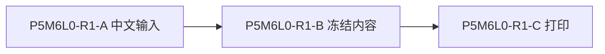
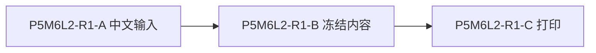

# P5M6 跨窗口文档 R1

P5M6-WINDOWED-R1-BODY

P5M6-WINDOW-001：中文分页内容，保留源码顺序、组合字符 é 和 emoji 👩🏽‍💻。

P5M6-WINDOW-002：中文分页内容，保留源码顺序、组合字符 é 和 emoji 👩🏽‍💻。

P5M6-WINDOW-003：中文分页内容，保留源码顺序、组合字符 é 和 emoji 👩🏽‍💻。

P5M6-WINDOW-004：中文分页内容，保留源码顺序、组合字符 é 和 emoji 👩🏽‍💻。

P5M6-WINDOW-005：中文分页内容，保留源码顺序、组合字符 é 和 emoji 👩🏽‍💻。

P5M6-WINDOW-006：中文分页内容，保留源码顺序、组合字符 é 和 emoji 👩🏽‍💻。

P5M6-WINDOW-007：中文分页内容，保留源码顺序、组合字符 é 和 emoji 👩🏽‍💻。

P5M6-WINDOW-008：中文分页内容，保留源码顺序、组合字符 é 和 emoji 👩🏽‍💻。

P5M6-WINDOW-009：中文分页内容，保留源码顺序、组合字符 é 和 emoji 👩🏽‍💻。

P5M6-WINDOW-010：中文分页内容，保留源码顺序、组合字符 é 和 emoji 👩🏽‍💻。

P5M6-WINDOW-011：中文分页内容，保留源码顺序、组合字符 é 和 emoji 👩🏽‍💻。

P5M6-WINDOW-012：中文分页内容，保留源码顺序、组合字符 é 和 emoji 👩🏽‍💻。

P5M6-WINDOW-013：中文分页内容，保留源码顺序、组合字符 é 和 emoji 👩🏽‍💻。

P5M6-WINDOW-014：中文分页内容，保留源码顺序、组合字符 é 和 emoji 👩🏽‍💻。

P5M6-WINDOW-015：中文分页内容，保留源码顺序、组合字符 é 和 emoji 👩🏽‍💻。

P5M6-WINDOW-016：中文分页内容，保留源码顺序、组合字符 é 和 emoji 👩🏽‍💻。

P5M6-WINDOW-017：中文分页内容，保留源码顺序、组合字符 é 和 emoji 👩🏽‍💻。

P5M6-WINDOW-018：中文分页内容，保留源码顺序、组合字符 é 和 emoji 👩🏽‍💻。

P5M6-WINDOW-019：中文分页内容，保留源码顺序、组合字符 é 和 emoji 👩🏽‍💻。

P5M6-WINDOW-020：中文分页内容，保留源码顺序、组合字符 é 和 emoji 👩🏽‍💻。

P5M6-WINDOW-021：中文分页内容，保留源码顺序、组合字符 é 和 emoji 👩🏽‍💻。

P5M6-WINDOW-022：中文分页内容，保留源码顺序、组合字符 é 和 emoji 👩🏽‍💻。

P5M6-WINDOW-023：中文分页内容，保留源码顺序、组合字符 é 和 emoji 👩🏽‍💻。

P5M6-WINDOW-024：中文分页内容，保留源码顺序、组合字符 é 和 emoji 👩🏽‍💻。

P5M6-WINDOW-025：中文分页内容，保留源码顺序、组合字符 é 和 emoji 👩🏽‍💻。

P5M6-WINDOW-026：中文分页内容，保留源码顺序、组合字符 é 和 emoji 👩🏽‍💻。

P5M6-WINDOW-027：中文分页内容，保留源码顺序、组合字符 é 和 emoji 👩🏽‍💻。

P5M6-WINDOW-028：中文分页内容，保留源码顺序、组合字符 é 和 emoji 👩🏽‍💻。

P5M6-WINDOW-029：中文分页内容，保留源码顺序、组合字符 é 和 emoji 👩🏽‍💻。

P5M6-WINDOW-030：中文分页内容，保留源码顺序、组合字符 é 和 emoji 👩🏽‍💻。

P5M6-WINDOW-031：中文分页内容，保留源码顺序、组合字符 é 和 emoji 👩🏽‍💻。

P5M6-WINDOW-032：中文分页内容，保留源码顺序、组合字符 é 和 emoji 👩🏽‍💻。

P5M6-WINDOW-033：中文分页内容，保留源码顺序、组合字符 é 和 emoji 👩🏽‍💻。

P5M6-WINDOW-034：中文分页内容，保留源码顺序、组合字符 é 和 emoji 👩🏽‍💻。

P5M6-WINDOW-035：中文分页内容，保留源码顺序、组合字符 é 和 emoji 👩🏽‍💻。

P5M6-WINDOW-036：中文分页内容，保留源码顺序、组合字符 é 和 emoji 👩🏽‍💻。

P5M6-WINDOW-037：中文分页内容，保留源码顺序、组合字符 é 和 emoji 👩🏽‍💻。

P5M6-WINDOW-038：中文分页内容，保留源码顺序、组合字符 é 和 emoji 👩🏽‍💻。

P5M6-WINDOW-039：中文分页内容，保留源码顺序、组合字符 é 和 emoji 👩🏽‍💻。

P5M6-WINDOW-040：中文分页内容，保留源码顺序、组合字符 é 和 emoji 👩🏽‍💻。

P5M6-WINDOW-041：中文分页内容，保留源码顺序、组合字符 é 和 emoji 👩🏽‍💻。

P5M6-WINDOW-042：中文分页内容，保留源码顺序、组合字符 é 和 emoji 👩🏽‍💻。

P5M6-WINDOW-043：中文分页内容，保留源码顺序、组合字符 é 和 emoji 👩🏽‍💻。

P5M6-WINDOW-044：中文分页内容，保留源码顺序、组合字符 é 和 emoji 👩🏽‍💻。

P5M6-WINDOW-045：中文分页内容，保留源码顺序、组合字符 é 和 emoji 👩🏽‍💻。

P5M6-WINDOW-046：中文分页内容，保留源码顺序、组合字符 é 和 emoji 👩🏽‍💻。

P5M6-WINDOW-047：中文分页内容，保留源码顺序、组合字符 é 和 emoji 👩🏽‍💻。

P5M6-WINDOW-048：中文分页内容，保留源码顺序、组合字符 é 和 emoji 👩🏽‍💻。

P5M6-WINDOW-049：中文分页内容，保留源码顺序、组合字符 é 和 emoji 👩🏽‍💻。

P5M6-WINDOW-050：中文分页内容，保留源码顺序、组合字符 é 和 emoji 👩🏽‍💻。

P5M6-WINDOW-051：中文分页内容，保留源码顺序、组合字符 é 和 emoji 👩🏽‍💻。

P5M6-WINDOW-052：中文分页内容，保留源码顺序、组合字符 é 和 emoji 👩🏽‍💻。

P5M6-WINDOW-053：中文分页内容，保留源码顺序、组合字符 é 和 emoji 👩🏽‍💻。

P5M6-WINDOW-054：中文分页内容，保留源码顺序、组合字符 é 和 emoji 👩🏽‍💻。

P5M6-WINDOW-055：中文分页内容，保留源码顺序、组合字符 é 和 emoji 👩🏽‍💻。

P5M6-WINDOW-056：中文分页内容，保留源码顺序、组合字符 é 和 emoji 👩🏽‍💻。

P5M6-WINDOW-057：中文分页内容，保留源码顺序、组合字符 é 和 emoji 👩🏽‍💻。

P5M6-WINDOW-058：中文分页内容，保留源码顺序、组合字符 é 和 emoji 👩🏽‍💻。

P5M6-WINDOW-059：中文分页内容，保留源码顺序、组合字符 é 和 emoji 👩🏽‍💻。

P5M6-WINDOW-060：中文分页内容，保留源码顺序、组合字符 é 和 emoji 👩🏽‍💻。

P5M6-WINDOW-061：中文分页内容，保留源码顺序、组合字符 é 和 emoji 👩🏽‍💻。

P5M6-WINDOW-062：中文分页内容，保留源码顺序、组合字符 é 和 emoji 👩🏽‍💻。

P5M6-WINDOW-063：中文分页内容，保留源码顺序、组合字符 é 和 emoji 👩🏽‍💻。

P5M6-WINDOW-064：中文分页内容，保留源码顺序、组合字符 é 和 emoji 👩🏽‍💻。

P5M6-WINDOW-065：中文分页内容，保留源码顺序、组合字符 é 和 emoji 👩🏽‍💻。

P5M6-WINDOW-066：中文分页内容，保留源码顺序、组合字符 é 和 emoji 👩🏽‍💻。

P5M6-WINDOW-067：中文分页内容，保留源码顺序、组合字符 é 和 emoji 👩🏽‍💻。

P5M6-WINDOW-068：中文分页内容，保留源码顺序、组合字符 é 和 emoji 👩🏽‍💻。

P5M6-WINDOW-069：中文分页内容，保留源码顺序、组合字符 é 和 emoji 👩🏽‍💻。

P5M6-WINDOW-070：中文分页内容，保留源码顺序、组合字符 é 和 emoji 👩🏽‍💻。

P5M6-WINDOW-071：中文分页内容，保留源码顺序、组合字符 é 和 emoji 👩🏽‍💻。

P5M6-WINDOW-072：中文分页内容，保留源码顺序、组合字符 é 和 emoji 👩🏽‍💻。

P5M6-WINDOW-073：中文分页内容，保留源码顺序、组合字符 é 和 emoji 👩🏽‍💻。

P5M6-WINDOW-074：中文分页内容，保留源码顺序、组合字符 é 和 emoji 👩🏽‍💻。

P5M6-WINDOW-075：中文分页内容，保留源码顺序、组合字符 é 和 emoji 👩🏽‍💻。

P5M6-WINDOW-076：中文分页内容，保留源码顺序、组合字符 é 和 emoji 👩🏽‍💻。

P5M6-WINDOW-077：中文分页内容，保留源码顺序、组合字符 é 和 emoji 👩🏽‍💻。

P5M6-WINDOW-078：中文分页内容，保留源码顺序、组合字符 é 和 emoji 👩🏽‍💻。

P5M6-WINDOW-079：中文分页内容，保留源码顺序、组合字符 é 和 emoji 👩🏽‍💻。

P5M6-WINDOW-080：中文分页内容，保留源码顺序、组合字符 é 和 emoji 👩🏽‍💻。

P5M6-WINDOW-081：中文分页内容，保留源码顺序、组合字符 é 和 emoji 👩🏽‍💻。

P5M6-WINDOW-082：中文分页内容，保留源码顺序、组合字符 é 和 emoji 👩🏽‍💻。

P5M6-WINDOW-083：中文分页内容，保留源码顺序、组合字符 é 和 emoji 👩🏽‍💻。

P5M6-WINDOW-084：中文分页内容，保留源码顺序、组合字符 é 和 emoji 👩🏽‍💻。

P5M6-WINDOW-085：中文分页内容，保留源码顺序、组合字符 é 和 emoji 👩🏽‍💻。

P5M6-WINDOW-086：中文分页内容，保留源码顺序、组合字符 é 和 emoji 👩🏽‍💻。

P5M6-WINDOW-087：中文分页内容，保留源码顺序、组合字符 é 和 emoji 👩🏽‍💻。

P5M6-WINDOW-088：中文分页内容，保留源码顺序、组合字符 é 和 emoji 👩🏽‍💻。

P5M6-WINDOW-089：中文分页内容，保留源码顺序、组合字符 é 和 emoji 👩🏽‍💻。

P5M6-WINDOW-090：中文分页内容，保留源码顺序、组合字符 é 和 emoji 👩🏽‍💻。

P5M6-WINDOW-091：中文分页内容，保留源码顺序、组合字符 é 和 emoji 👩🏽‍💻。

P5M6-WINDOW-092：中文分页内容，保留源码顺序、组合字符 é 和 emoji 👩🏽‍💻。

P5M6-WINDOW-093：中文分页内容，保留源码顺序、组合字符 é 和 emoji 👩🏽‍💻。

P5M6-WINDOW-094：中文分页内容，保留源码顺序、组合字符 é 和 emoji 👩🏽‍💻。

P5M6-WINDOW-095：中文分页内容，保留源码顺序、组合字符 é 和 emoji 👩🏽‍💻。

P5M6-WINDOW-096：中文分页内容，保留源码顺序、组合字符 é 和 emoji 👩🏽‍💻。

P5M6-WINDOW-097：中文分页内容，保留源码顺序、组合字符 é 和 emoji 👩🏽‍💻。

P5M6-WINDOW-098：中文分页内容，保留源码顺序、组合字符 é 和 emoji 👩🏽‍💻。

P5M6-WINDOW-099：中文分页内容，保留源码顺序、组合字符 é 和 emoji 👩🏽‍💻。

P5M6-WINDOW-100：中文分页内容，保留源码顺序、组合字符 é 和 emoji 👩🏽‍💻。

P5M6-WINDOW-101：中文分页内容，保留源码顺序、组合字符 é 和 emoji 👩🏽‍💻。

P5M6-WINDOW-102：中文分页内容，保留源码顺序、组合字符 é 和 emoji 👩🏽‍💻。

P5M6-WINDOW-103：中文分页内容，保留源码顺序、组合字符 é 和 emoji 👩🏽‍💻。

P5M6-WINDOW-104：中文分页内容，保留源码顺序、组合字符 é 和 emoji 👩🏽‍💻。

P5M6-WINDOW-105：中文分页内容，保留源码顺序、组合字符 é 和 emoji 👩🏽‍💻。

P5M6-WINDOW-106：中文分页内容，保留源码顺序、组合字符 é 和 emoji 👩🏽‍💻。

P5M6-WINDOW-107：中文分页内容，保留源码顺序、组合字符 é 和 emoji 👩🏽‍💻。

P5M6-WINDOW-108：中文分页内容，保留源码顺序、组合字符 é 和 emoji 👩🏽‍💻。

P5M6-WINDOW-109：中文分页内容，保留源码顺序、组合字符 é 和 emoji 👩🏽‍💻。

P5M6-WINDOW-110：中文分页内容，保留源码顺序、组合字符 é 和 emoji 👩🏽‍💻。

P5M6-WINDOW-111：中文分页内容，保留源码顺序、组合字符 é 和 emoji 👩🏽‍💻。

P5M6-WINDOW-112：中文分页内容，保留源码顺序、组合字符 é 和 emoji 👩🏽‍💻。

P5M6-WINDOW-113：中文分页内容，保留源码顺序、组合字符 é 和 emoji 👩🏽‍💻。

P5M6-WINDOW-114：中文分页内容，保留源码顺序、组合字符 é 和 emoji 👩🏽‍💻。

P5M6-WINDOW-115：中文分页内容，保留源码顺序、组合字符 é 和 emoji 👩🏽‍💻。

P5M6-WINDOW-116：中文分页内容，保留源码顺序、组合字符 é 和 emoji 👩🏽‍💻。

P5M6-WINDOW-117：中文分页内容，保留源码顺序、组合字符 é 和 emoji 👩🏽‍💻。

P5M6-WINDOW-118：中文分页内容，保留源码顺序、组合字符 é 和 emoji 👩🏽‍💻。

P5M6-WINDOW-119：中文分页内容，保留源码顺序、组合字符 é 和 emoji 👩🏽‍💻。

P5M6-WINDOW-120：中文分页内容，保留源码顺序、组合字符 é 和 emoji 👩🏽‍💻。

P5M6-WINDOW-121：中文分页内容，保留源码顺序、组合字符 é 和 emoji 👩🏽‍💻。

P5M6-WINDOW-122：中文分页内容，保留源码顺序、组合字符 é 和 emoji 👩🏽‍💻。

P5M6-WINDOW-123：中文分页内容，保留源码顺序、组合字符 é 和 emoji 👩🏽‍💻。

P5M6-WINDOW-124：中文分页内容，保留源码顺序、组合字符 é 和 emoji 👩🏽‍💻。

P5M6-WINDOW-125：中文分页内容，保留源码顺序、组合字符 é 和 emoji 👩🏽‍💻。

P5M6-WINDOW-126：中文分页内容，保留源码顺序、组合字符 é 和 emoji 👩🏽‍💻。

P5M6-WINDOW-127：中文分页内容，保留源码顺序、组合字符 é 和 emoji 👩🏽‍💻。

P5M6-WINDOW-128：中文分页内容，保留源码顺序、组合字符 é 和 emoji 👩🏽‍💻。

P5M6-WINDOW-129：中文分页内容，保留源码顺序、组合字符 é 和 emoji 👩🏽‍💻。

P5M6-WINDOW-130：中文分页内容，保留源码顺序、组合字符 é 和 emoji 👩🏽‍💻。

P5M6-WINDOW-131：中文分页内容，保留源码顺序、组合字符 é 和 emoji 👩🏽‍💻。

P5M6-WINDOW-132：中文分页内容，保留源码顺序、组合字符 é 和 emoji 👩🏽‍💻。

P5M6-WINDOW-133：中文分页内容，保留源码顺序、组合字符 é 和 emoji 👩🏽‍💻。

P5M6-WINDOW-134：中文分页内容，保留源码顺序、组合字符 é 和 emoji 👩🏽‍💻。

P5M6-WINDOW-135：中文分页内容，保留源码顺序、组合字符 é 和 emoji 👩🏽‍💻。

P5M6-WINDOW-136：中文分页内容，保留源码顺序、组合字符 é 和 emoji 👩🏽‍💻。

P5M6-WINDOW-137：中文分页内容，保留源码顺序、组合字符 é 和 emoji 👩🏽‍💻。

P5M6-WINDOW-138：中文分页内容，保留源码顺序、组合字符 é 和 emoji 👩🏽‍💻。

P5M6-WINDOW-139：中文分页内容，保留源码顺序、组合字符 é 和 emoji 👩🏽‍💻。

P5M6-WINDOW-140：中文分页内容，保留源码顺序、组合字符 é 和 emoji 👩🏽‍💻。

P5M6-WINDOW-141：中文分页内容，保留源码顺序、组合字符 é 和 emoji 👩🏽‍💻。

P5M6-WINDOW-142：中文分页内容，保留源码顺序、组合字符 é 和 emoji 👩🏽‍💻。

P5M6-WINDOW-143：中文分页内容，保留源码顺序、组合字符 é 和 emoji 👩🏽‍💻。

P5M6-WINDOW-144：中文分页内容，保留源码顺序、组合字符 é 和 emoji 👩🏽‍💻。

P5M6-WINDOW-145：中文分页内容，保留源码顺序、组合字符 é 和 emoji 👩🏽‍💻。

P5M6-WINDOW-146：中文分页内容，保留源码顺序、组合字符 é 和 emoji 👩🏽‍💻。

P5M6-WINDOW-147：中文分页内容，保留源码顺序、组合字符 é 和 emoji 👩🏽‍💻。

P5M6-WINDOW-148：中文分页内容，保留源码顺序、组合字符 é 和 emoji 👩🏽‍💻。

P5M6-WINDOW-149：中文分页内容，保留源码顺序、组合字符 é 和 emoji 👩🏽‍💻。

P5M6-WINDOW-150：中文分页内容，保留源码顺序、组合字符 é 和 emoji 👩🏽‍💻。

P5M6-WINDOW-151：中文分页内容，保留源码顺序、组合字符 é 和 emoji 👩🏽‍💻。

P5M6-WINDOW-152：中文分页内容，保留源码顺序、组合字符 é 和 emoji 👩🏽‍💻。

P5M6-WINDOW-153：中文分页内容，保留源码顺序、组合字符 é 和 emoji 👩🏽‍💻。

P5M6-WINDOW-154：中文分页内容，保留源码顺序、组合字符 é 和 emoji 👩🏽‍💻。

P5M6-WINDOW-155：中文分页内容，保留源码顺序、组合字符 é 和 emoji 👩🏽‍💻。

P5M6-WINDOW-156：中文分页内容，保留源码顺序、组合字符 é 和 emoji 👩🏽‍💻。

P5M6-WINDOW-157：中文分页内容，保留源码顺序、组合字符 é 和 emoji 👩🏽‍💻。

P5M6-WINDOW-158：中文分页内容，保留源码顺序、组合字符 é 和 emoji 👩🏽‍💻。

P5M6-WINDOW-159：中文分页内容，保留源码顺序、组合字符 é 和 emoji 👩🏽‍💻。

P5M6-WINDOW-160：中文分页内容，保留源码顺序、组合字符 é 和 emoji 👩🏽‍💻。

P5M6-WINDOW-161：中文分页内容，保留源码顺序、组合字符 é 和 emoji 👩🏽‍💻。

P5M6-WINDOW-162：中文分页内容，保留源码顺序、组合字符 é 和 emoji 👩🏽‍💻。

P5M6-WINDOW-163：中文分页内容，保留源码顺序、组合字符 é 和 emoji 👩🏽‍💻。

P5M6-WINDOW-164：中文分页内容，保留源码顺序、组合字符 é 和 emoji 👩🏽‍💻。

P5M6-WINDOW-165：中文分页内容，保留源码顺序、组合字符 é 和 emoji 👩🏽‍💻。

P5M6-WINDOW-166：中文分页内容，保留源码顺序、组合字符 é 和 emoji 👩🏽‍💻。

P5M6-WINDOW-167：中文分页内容，保留源码顺序、组合字符 é 和 emoji 👩🏽‍💻。

P5M6-WINDOW-168：中文分页内容，保留源码顺序、组合字符 é 和 emoji 👩🏽‍💻。

P5M6-WINDOW-169：中文分页内容，保留源码顺序、组合字符 é 和 emoji 👩🏽‍💻。

P5M6-WINDOW-170：中文分页内容，保留源码顺序、组合字符 é 和 emoji 👩🏽‍💻。

P5M6-WINDOW-171：中文分页内容，保留源码顺序、组合字符 é 和 emoji 👩🏽‍💻。

P5M6-WINDOW-172：中文分页内容，保留源码顺序、组合字符 é 和 emoji 👩🏽‍💻。

P5M6-WINDOW-173：中文分页内容，保留源码顺序、组合字符 é 和 emoji 👩🏽‍💻。

P5M6-WINDOW-174：中文分页内容，保留源码顺序、组合字符 é 和 emoji 👩🏽‍💻。

P5M6-WINDOW-175：中文分页内容，保留源码顺序、组合字符 é 和 emoji 👩🏽‍💻。

P5M6-WINDOW-176：中文分页内容，保留源码顺序、组合字符 é 和 emoji 👩🏽‍💻。

P5M6-WINDOW-177：中文分页内容，保留源码顺序、组合字符 é 和 emoji 👩🏽‍💻。

P5M6-WINDOW-178：中文分页内容，保留源码顺序、组合字符 é 和 emoji 👩🏽‍💻。

P5M6-WINDOW-179：中文分页内容，保留源码顺序、组合字符 é 和 emoji 👩🏽‍💻。

P5M6-WINDOW-180：中文分页内容，保留源码顺序、组合字符 é 和 emoji 👩🏽‍💻。

P5M6-WINDOW-181：中文分页内容，保留源码顺序、组合字符 é 和 emoji 👩🏽‍💻。

P5M6-WINDOW-182：中文分页内容，保留源码顺序、组合字符 é 和 emoji 👩🏽‍💻。

P5M6-WINDOW-183：中文分页内容，保留源码顺序、组合字符 é 和 emoji 👩🏽‍💻。

P5M6-WINDOW-184：中文分页内容，保留源码顺序、组合字符 é 和 emoji 👩🏽‍💻。

P5M6-WINDOW-185：中文分页内容，保留源码顺序、组合字符 é 和 emoji 👩🏽‍💻。

P5M6-WINDOW-186：中文分页内容，保留源码顺序、组合字符 é 和 emoji 👩🏽‍💻。

P5M6-WINDOW-187：中文分页内容，保留源码顺序、组合字符 é 和 emoji 👩🏽‍💻。

P5M6-WINDOW-188：中文分页内容，保留源码顺序、组合字符 é 和 emoji 👩🏽‍💻。

P5M6-WINDOW-189：中文分页内容，保留源码顺序、组合字符 é 和 emoji 👩🏽‍💻。

P5M6-WINDOW-190：中文分页内容，保留源码顺序、组合字符 é 和 emoji 👩🏽‍💻。

P5M6-WINDOW-191：中文分页内容，保留源码顺序、组合字符 é 和 emoji 👩🏽‍💻。

P5M6-WINDOW-192：中文分页内容，保留源码顺序、组合字符 é 和 emoji 👩🏽‍💻。

P5M6-WINDOW-193：中文分页内容，保留源码顺序、组合字符 é 和 emoji 👩🏽‍💻。

P5M6-WINDOW-194：中文分页内容，保留源码顺序、组合字符 é 和 emoji 👩🏽‍💻。

P5M6-WINDOW-195：中文分页内容，保留源码顺序、组合字符 é 和 emoji 👩🏽‍💻。

P5M6-WINDOW-196：中文分页内容，保留源码顺序、组合字符 é 和 emoji 👩🏽‍💻。

P5M6-WINDOW-197：中文分页内容，保留源码顺序、组合字符 é 和 emoji 👩🏽‍💻。

P5M6-WINDOW-198：中文分页内容，保留源码顺序、组合字符 é 和 emoji 👩🏽‍💻。

P5M6-WINDOW-199：中文分页内容，保留源码顺序、组合字符 é 和 emoji 👩🏽‍💻。

P5M6-WINDOW-200：中文分页内容，保留源码顺序、组合字符 é 和 emoji 👩🏽‍💻。

P5M6-WINDOW-201：中文分页内容，保留源码顺序、组合字符 é 和 emoji 👩🏽‍💻。

P5M6-WINDOW-202：中文分页内容，保留源码顺序、组合字符 é 和 emoji 👩🏽‍💻。

P5M6-WINDOW-203：中文分页内容，保留源码顺序、组合字符 é 和 emoji 👩🏽‍💻。

P5M6-WINDOW-204：中文分页内容，保留源码顺序、组合字符 é 和 emoji 👩🏽‍💻。

P5M6-WINDOW-205：中文分页内容，保留源码顺序、组合字符 é 和 emoji 👩🏽‍💻。

P5M6-WINDOW-206：中文分页内容，保留源码顺序、组合字符 é 和 emoji 👩🏽‍💻。

P5M6-WINDOW-207：中文分页内容，保留源码顺序、组合字符 é 和 emoji 👩🏽‍💻。

P5M6-WINDOW-208：中文分页内容，保留源码顺序、组合字符 é 和 emoji 👩🏽‍💻。

P5M6-WINDOW-209：中文分页内容，保留源码顺序、组合字符 é 和 emoji 👩🏽‍💻。

P5M6-WINDOW-210：中文分页内容，保留源码顺序、组合字符 é 和 emoji 👩🏽‍💻。

P5M6-WINDOW-211：中文分页内容，保留源码顺序、组合字符 é 和 emoji 👩🏽‍💻。

P5M6-WINDOW-212：中文分页内容，保留源码顺序、组合字符 é 和 emoji 👩🏽‍💻。

P5M6-WINDOW-213：中文分页内容，保留源码顺序、组合字符 é 和 emoji 👩🏽‍💻。

P5M6-WINDOW-214：中文分页内容，保留源码顺序、组合字符 é 和 emoji 👩🏽‍💻。

P5M6-WINDOW-215：中文分页内容，保留源码顺序、组合字符 é 和 emoji 👩🏽‍💻。

P5M6-WINDOW-216：中文分页内容，保留源码顺序、组合字符 é 和 emoji 👩🏽‍💻。

P5M6-WINDOW-217：中文分页内容，保留源码顺序、组合字符 é 和 emoji 👩🏽‍💻。

P5M6-WINDOW-218：中文分页内容，保留源码顺序、组合字符 é 和 emoji 👩🏽‍💻。

P5M6-WINDOW-219：中文分页内容，保留源码顺序、组合字符 é 和 emoji 👩🏽‍💻。

P5M6-WINDOW-220：中文分页内容，保留源码顺序、组合字符 é 和 emoji 👩🏽‍💻。

P5M6-WINDOW-221：中文分页内容，保留源码顺序、组合字符 é 和 emoji 👩🏽‍💻。

P5M6-WINDOW-222：中文分页内容，保留源码顺序、组合字符 é 和 emoji 👩🏽‍💻。

P5M6-WINDOW-223：中文分页内容，保留源码顺序、组合字符 é 和 emoji 👩🏽‍💻。

P5M6-WINDOW-224：中文分页内容，保留源码顺序、组合字符 é 和 emoji 👩🏽‍💻。

P5M6-WINDOW-225：中文分页内容，保留源码顺序、组合字符 é 和 emoji 👩🏽‍💻。

P5M6-WINDOW-226：中文分页内容，保留源码顺序、组合字符 é 和 emoji 👩🏽‍💻。

P5M6-WINDOW-227：中文分页内容，保留源码顺序、组合字符 é 和 emoji 👩🏽‍💻。

P5M6-WINDOW-228：中文分页内容，保留源码顺序、组合字符 é 和 emoji 👩🏽‍💻。

P5M6-WINDOW-229：中文分页内容，保留源码顺序、组合字符 é 和 emoji 👩🏽‍💻。

P5M6-WINDOW-230：中文分页内容，保留源码顺序、组合字符 é 和 emoji 👩🏽‍💻。

P5M6-WINDOW-231：中文分页内容，保留源码顺序、组合字符 é 和 emoji 👩🏽‍💻。

P5M6-WINDOW-232：中文分页内容，保留源码顺序、组合字符 é 和 emoji 👩🏽‍💻。

P5M6-WINDOW-233：中文分页内容，保留源码顺序、组合字符 é 和 emoji 👩🏽‍💻。

P5M6-WINDOW-234：中文分页内容，保留源码顺序、组合字符 é 和 emoji 👩🏽‍💻。

P5M6-WINDOW-235：中文分页内容，保留源码顺序、组合字符 é 和 emoji 👩🏽‍💻。

P5M6-WINDOW-236：中文分页内容，保留源码顺序、组合字符 é 和 emoji 👩🏽‍💻。

P5M6-WINDOW-237：中文分页内容，保留源码顺序、组合字符 é 和 emoji 👩🏽‍💻。

P5M6-WINDOW-238：中文分页内容，保留源码顺序、组合字符 é 和 emoji 👩🏽‍💻。

P5M6-WINDOW-239：中文分页内容，保留源码顺序、组合字符 é 和 emoji 👩🏽‍💻。

P5M6-WINDOW-240：中文分页内容，保留源码顺序、组合字符 é 和 emoji 👩🏽‍💻。

P5M6-WINDOW-241：中文分页内容，保留源码顺序、组合字符 é 和 emoji 👩🏽‍💻。

P5M6-WINDOW-242：中文分页内容，保留源码顺序、组合字符 é 和 emoji 👩🏽‍💻。

P5M6-WINDOW-243：中文分页内容，保留源码顺序、组合字符 é 和 emoji 👩🏽‍💻。

P5M6-WINDOW-244：中文分页内容，保留源码顺序、组合字符 é 和 emoji 👩🏽‍💻。

P5M6-WINDOW-245：中文分页内容，保留源码顺序、组合字符 é 和 emoji 👩🏽‍💻。

P5M6-WINDOW-246：中文分页内容，保留源码顺序、组合字符 é 和 emoji 👩🏽‍💻。

P5M6-WINDOW-247：中文分页内容，保留源码顺序、组合字符 é 和 emoji 👩🏽‍💻。

P5M6-WINDOW-248：中文分页内容，保留源码顺序、组合字符 é 和 emoji 👩🏽‍💻。

P5M6-WINDOW-249：中文分页内容，保留源码顺序、组合字符 é 和 emoji 👩🏽‍💻。

P5M6-WINDOW-250：中文分页内容，保留源码顺序、组合字符 é 和 emoji 👩🏽‍💻。

P5M6-WINDOW-251：中文分页内容，保留源码顺序、组合字符 é 和 emoji 👩🏽‍💻。

P5M6-WINDOW-252：中文分页内容，保留源码顺序、组合字符 é 和 emoji 👩🏽‍💻。

P5M6-WINDOW-253：中文分页内容，保留源码顺序、组合字符 é 和 emoji 👩🏽‍💻。

P5M6-WINDOW-254：中文分页内容，保留源码顺序、组合字符 é 和 emoji 👩🏽‍💻。

P5M6-WINDOW-255：中文分页内容，保留源码顺序、组合字符 é 和 emoji 👩🏽‍💻。

P5M6-WINDOW-256：中文分页内容，保留源码顺序、组合字符 é 和 emoji 👩🏽‍💻。

P5M6-WINDOW-257：中文分页内容，保留源码顺序、组合字符 é 和 emoji 👩🏽‍💻。

P5M6-WINDOW-258：中文分页内容，保留源码顺序、组合字符 é 和 emoji 👩🏽‍💻。

P5M6-WINDOW-259：中文分页内容，保留源码顺序、组合字符 é 和 emoji 👩🏽‍💻。

P5M6-WINDOW-260：中文分页内容，保留源码顺序、组合字符 é 和 emoji 👩🏽‍💻。

P5M6-WINDOW-261：中文分页内容，保留源码顺序、组合字符 é 和 emoji 👩🏽‍💻。

P5M6-WINDOW-262：中文分页内容，保留源码顺序、组合字符 é 和 emoji 👩🏽‍💻。

P5M6-WINDOW-263：中文分页内容，保留源码顺序、组合字符 é 和 emoji 👩🏽‍💻。

P5M6-WINDOW-264：中文分页内容，保留源码顺序、组合字符 é 和 emoji 👩🏽‍💻。

P5M6-WINDOW-265：中文分页内容，保留源码顺序、组合字符 é 和 emoji 👩🏽‍💻。

P5M6-WINDOW-266：中文分页内容，保留源码顺序、组合字符 é 和 emoji 👩🏽‍💻。

P5M6-WINDOW-267：中文分页内容，保留源码顺序、组合字符 é 和 emoji 👩🏽‍💻。

P5M6-WINDOW-268：中文分页内容，保留源码顺序、组合字符 é 和 emoji 👩🏽‍💻。

P5M6-WINDOW-269：中文分页内容，保留源码顺序、组合字符 é 和 emoji 👩🏽‍💻。

P5M6-WINDOW-270：中文分页内容，保留源码顺序、组合字符 é 和 emoji 👩🏽‍💻。

P5M6-WINDOW-271：中文分页内容，保留源码顺序、组合字符 é 和 emoji 👩🏽‍💻。

P5M6-WINDOW-272：中文分页内容，保留源码顺序、组合字符 é 和 emoji 👩🏽‍💻。

P5M6-WINDOW-273：中文分页内容，保留源码顺序、组合字符 é 和 emoji 👩🏽‍💻。

P5M6-WINDOW-274：中文分页内容，保留源码顺序、组合字符 é 和 emoji 👩🏽‍💻。

P5M6-WINDOW-275：中文分页内容，保留源码顺序、组合字符 é 和 emoji 👩🏽‍💻。

P5M6-WINDOW-276：中文分页内容，保留源码顺序、组合字符 é 和 emoji 👩🏽‍💻。

P5M6-WINDOW-277：中文分页内容，保留源码顺序、组合字符 é 和 emoji 👩🏽‍💻。

P5M6-WINDOW-278：中文分页内容，保留源码顺序、组合字符 é 和 emoji 👩🏽‍💻。

P5M6-WINDOW-279：中文分页内容，保留源码顺序、组合字符 é 和 emoji 👩🏽‍💻。

P5M6-WINDOW-280：中文分页内容，保留源码顺序、组合字符 é 和 emoji 👩🏽‍💻。

P5M6-WINDOW-281：中文分页内容，保留源码顺序、组合字符 é 和 emoji 👩🏽‍💻。

P5M6-WINDOW-282：中文分页内容，保留源码顺序、组合字符 é 和 emoji 👩🏽‍💻。

P5M6-WINDOW-283：中文分页内容，保留源码顺序、组合字符 é 和 emoji 👩🏽‍💻。

P5M6-WINDOW-284：中文分页内容，保留源码顺序、组合字符 é 和 emoji 👩🏽‍💻。

P5M6-WINDOW-285：中文分页内容，保留源码顺序、组合字符 é 和 emoji 👩🏽‍💻。

P5M6-WINDOW-286：中文分页内容，保留源码顺序、组合字符 é 和 emoji 👩🏽‍💻。

P5M6-WINDOW-287：中文分页内容，保留源码顺序、组合字符 é 和 emoji 👩🏽‍💻。

P5M6-WINDOW-288：中文分页内容，保留源码顺序、组合字符 é 和 emoji 👩🏽‍💻。

P5M6-WINDOW-289：中文分页内容，保留源码顺序、组合字符 é 和 emoji 👩🏽‍💻。

P5M6-WINDOW-290：中文分页内容，保留源码顺序、组合字符 é 和 emoji 👩🏽‍💻。

P5M6-WINDOW-291：中文分页内容，保留源码顺序、组合字符 é 和 emoji 👩🏽‍💻。

P5M6-WINDOW-292：中文分页内容，保留源码顺序、组合字符 é 和 emoji 👩🏽‍💻。

P5M6-WINDOW-293：中文分页内容，保留源码顺序、组合字符 é 和 emoji 👩🏽‍💻。

P5M6-WINDOW-294：中文分页内容，保留源码顺序、组合字符 é 和 emoji 👩🏽‍💻。

P5M6-WINDOW-295：中文分页内容，保留源码顺序、组合字符 é 和 emoji 👩🏽‍💻。

P5M6-WINDOW-296：中文分页内容，保留源码顺序、组合字符 é 和 emoji 👩🏽‍💻。

P5M6-WINDOW-297：中文分页内容，保留源码顺序、组合字符 é 和 emoji 👩🏽‍💻。

P5M6-WINDOW-298：中文分页内容，保留源码顺序、组合字符 é 和 emoji 👩🏽‍💻。

P5M6-WINDOW-299：中文分页内容，保留源码顺序、组合字符 é 和 emoji 👩🏽‍💻。

P5M6-WINDOW-300：中文分页内容，保留源码顺序、组合字符 é 和 emoji 👩🏽‍💻。

P5M6-WINDOWED-R1-END
